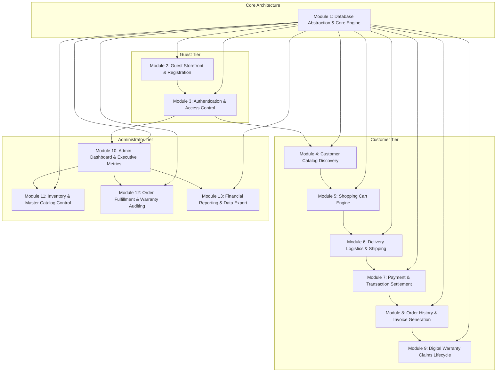

# COMPLETE MODULE DOCUMENTATION: OrchestraOne (MelodyMart)
**Detailed Technical Specification of All System Modules**

---

## 1. Architectural Module Breakdown

OrchestraOne is organized into 12 tightly integrated functional modules spanning the Guest, Customer, Administrator, and Core Database tiers:

---

## Module 1: Database Abstraction & Core Engine
* **Purpose:** Provides a centralized, reusable database wrapper class (`dboperation`) that encapsulates the MySQL connection, query execution, error reporting, and character set initialization.
* **Access Control:** System-wide internal component (invoked by every backend PHP script).
* **Input Data:** Raw SQL query strings (`SELECT`, `INSERT`, `UPDATE`, `DELETE`, `ALTER`).
* **Processing Logic:** 
  1. Initializes a persistent MySQL connection using `mysqli_connect("localhost", "root", "", "db_orchestraone")`.
  2. Verifies connection health; halts execution with diagnostic message on failure.
  3. Executes the query via `mysqli_query($this->con, $sql)` and returns the resulting `mysqli_result` object or boolean status.
* **Output Generated:** MySQL result sets or boolean execution flags.
* **Database Tables Involved:** All tables in `db_orchestraone`.
* **Important Methods:** `__construct()`, `executequery($sql)`.
* **Related Files:** `c:\wamp64\www\OrchestraOne\dboperation.php`.
* **Working Procedure:** Included at the start of any PHP file (`include_once("../dboperation.php"); $obj = new dboperation(); $res = $obj->executequery($query);`).

---

## Module 2: Guest Storefront & Registration
* **Purpose:** Introduces unauthenticated visitors to the platform, displays featured musical gear, and onboard new musicians through a validated registration workflow.
* **Access Control:** Public / Unauthenticated Visitors.
* **Input Data:** Full Name, District, Location ID, Phone Number, Email, Username, Password, Confirm Password.
* **Processing Logic:**
  1. Visitors browse high-level categories and featured instruments on `Guest/index.php`.
  2. On clicking **Customer Registration**, `Guest/cusreg.php` queries `tbl_district` and populates the district dropdown.
  3. When a user selects a district, jQuery fires an AJAX request to `Guest/getloc_drop.php`, returning corresponding locations.
  4. As the user enters a username, an asynchronous `keyup` event sends an AJAX request to `Guest/check_username.php`, querying `tbl_customer` to verify availability.
  5. On submit, `Guest/cusregaction.php` sanitizes inputs, checks for existing usernames/emails, inserts the record into `tbl_customer`, and invokes `phpmailer.php` (if configured) before redirecting to `login.php`.
* **Output Generated:** Customer profile record in database, registration confirmation alert, email notification dispatch.
* **Database Tables Involved:** `tbl_customer`, `tbl_district`, `tbl_location`.
* **Related Files:** 
  * `Guest/index.php`
  * `Guest/cusreg.php`
  * `Guest/cusregaction.php`
  * `Guest/getloc_drop.php`
  * `Guest/check_username.php`
  * `Guest/phpmailer.php`
* **Inter-Module Relationship:** Supplies verified customer accounts for Module 3 (Authentication).

---

## Module 3: Authentication & Access Control
* **Purpose:** Manages system login, credential verification, dual-role routing, session initialization, and secure termination.
* **Access Control:** Public login form, protected redirects.
* **Input Data:** `username`, `password`, optional `redirect` return path.
* **Processing Logic:**
  1. `Guest/login.php` accepts user credentials with client-side visibility toggle.
  2. Submits to `Guest/loginaction.php`.
  3. **Step 1:** Queries `tbl_adminlogin WHERE username='$username' AND password='$password'`. If matched, initializes `$_SESSION["username"]`, `$_SESSION["Login_id"]`, and redirects to `../Admin/index.php`.
  4. **Step 2:** If not an admin, queries `tbl_customer WHERE username='$username' AND password='$password'`. If matched, initializes `$_SESSION["username"]`, `$_SESSION["customer_id"]`, and redirects to `../Customer/index.php` (or original target from `$_POST['redirect']`).
  5. **Step 3:** If neither matches, fires JavaScript alert `"Invalid Username or Password"` and redirects to `login.php`.
  6. Logout (`logout.php`) destroys the session (`session_destroy()`) and returns the user to `Guest/index.php`.
* **Output Generated:** Active PHP session state (`$_SESSION['customer_id']` or `$_SESSION['Login_id']`).
* **Database Tables Involved:** `tbl_adminlogin`, `tbl_customer`.
* **Related Files:** 
  * `Guest/login.php`
  * `Guest/loginaction.php`
  * `logout.php`
* **Inter-Module Relationship:** Controls entry gates to Customer and Admin portals.

---

## Module 4: Customer Catalog Discovery
* **Purpose:** Enables musicians to search, filter, and inspect musical instruments across two distinct taxonomic tiers.
* **Access Control:** Registered Customers (`$_SESSION['customer_id']`).
* **Input Data:** `categoryid` (GET), `subcatid` (GET), `productid` (GET).
* **Processing Logic:**
  1. `Customer/catview.php` displays all instrument families from `tbl_category` (e.g. Stringed, Keyboards, Drums).
  2. Selecting a category loads `Customer/subcatview.php`, querying `tbl_subcategory WHERE category_id = '$categoryid'`.
  3. Selecting a subcategory loads `Customer/productview.php`, querying `tbl_product WHERE subcat = '$subcatid'`.
  4. Clicking an individual instrument opens `Customer/ptview.php`, fetching full instrument details, brand data, tonewood profiles, master luthier badges, and stock levels.
  5. Checks `tbl_cart` to see if the active customer already added this instrument; renders visual badges accordingly.
* **Output Generated:** Visual instrument display, dynamic quantity controls, price formatting.
* **Database Tables Involved:** `tbl_category`, `tbl_subcategory`, `tbl_product`, `tbl_cart`.
* **Related Files:**
  * `Customer/index.php`
  * `Customer/catview.php`
  * `Customer/subcatview.php`
  * `Customer/productview.php`
  * `Customer/ptview.php`
* **Inter-Module Relationship:** Feeds instrument selections directly into Module 5 (Shopping Cart).

---

## Module 5: Shopping Cart Engine
* **Purpose:** Manages the customer's active cart state, dynamically recalculates totals, enforces inventory limits, and blocks duplicate items.
* **Access Control:** Authenticated Customers.
* **Input Data:** `productid`, `quantity`, `totalamount`, `cartid`, `action` (`inc` / `dec`).
* **Processing Logic:**
  1. On `Customer/ptview.php`, user selects quantity and clicks **Add to Cart** (posts to `cartaction.php`).
  2. `cartaction.php` queries `tbl_cart WHERE product_id = '$pid' AND customer_id = '$customerid' AND status = 'cart'`.
  3. **Duplicate Prevention:** If a record exists, execution halts with alert `"Item is already in cart"` and redirects to `cartview.php`.
  4. If new, inserts a new row into `tbl_cart` (`product_id, quantity, totalamount, customer_id, cart_date, status='cart'`).
  5. `Customer/cartview.php` aggregates all items for this customer, calculating line totals and grand total.
  6. Quantity steppers link to `Customer/updatecart.php?action=inc&cartid=X` or `dec`:
     * Validates that quantity does not exceed `tbl_product.stock` or fall below 1.
     * Updates `tbl_cart` with new quantity and recalculated `totalamount = quantity * amount`.
  7. Items can be removed via `Customer/deletecart.php?cartid=X` (`DELETE FROM tbl_cart WHERE cart_id = '$lid'`).
* **Output Generated:** Dynamic shopping cart table, subtotal and tax summaries, checkout navigation buttons.
* **Database Tables Involved:** `tbl_cart`, `tbl_product`, `tbl_subcategory`, `tbl_category`.
* **Related Files:**
  * `Customer/cartaction.php`
  * `Customer/cartview.php`
  * `Customer/updatecart.php`
  * `Customer/deletecart.php`
* **Inter-Module Relationship:** Hands the aggregated cart over to Module 6 (Delivery Logistics) and Module 7 (Payment).

---

## Module 6: Delivery Logistics & Shipping
* **Purpose:** Captures, verifies, and attaches physical shipping destinations to pending orders.
* **Access Control:** Authenticated Customers with items in active cart.
* **Input Data:** `name`, `mobno`, `address`, `pincode`.
* **Processing Logic:**
  1. `Customer/deliveryaddress.php` renders Step 2 of the checkout stepper.
  2. Pre-populates with any previously saved shipping address linked to the customer's past orders.
  3. Validates recipient name (alphabetic), 10-digit mobile number, full street address, and 6-digit postal pincode.
  4. Stores data temporarily in session or passes forward to the final payment authorization form.
* **Output Generated:** Validated delivery address structure ready for database persistence upon checkout completion.
* **Database Tables Involved:** `tbl_deliveryaddress`, `tbl_cartmaster`, `tbl_customer`.
* **Related Files:** `Customer/deliveryaddress.php`.
* **Inter-Module Relationship:** Supplies destination details for Module 7 (Payment) and Module 12 (Admin Dispatch).

---

## Module 7: Payment & Transaction Settlement
* **Purpose:** Finalizes order commitments, persists master orders, decrements product stock, logs payment records, and commits shipping addresses.
* **Access Control:** Authenticated Customers.
* **Input Data:** Cardholder name, Card number, Expiry, CVV, shipping address inputs, cart grand total.
* **Processing Logic (Transaction Pipeline):**
  1. `Customer/payment.php` displays order breakdown and secure payment card form.
  2. Client-side JS validates 16-digit card number, future expiration date, and 3-digit CVV.
  3. Form submits to `Customer/paymentaction.php`.
  4. **Step 1:** Inserts into `tbl_cartmaster` (`grandtotal, customer_id, cmstatus='Paid'`), capturing the generated `cartmaster_id`.
  5. **Step 2:** Inserts into `tbl_payment` (`cartmaster_id, payment_date, pamount, customer_id, pstatus='Paid', commission`).
  6. **Step 3:** Inserts into `tbl_deliveryaddress` (`personname, mobno, address, pincode, cartmasterid`).
  7. **Step 4:** Updates `tbl_cart SET status='paid', cartmaster_id='$cartId' WHERE customer_id='$customerid' AND status='cart'`.
  8. **Step 5 (Inventory Sync):** For every purchased item, executes `UPDATE tbl_product SET stock = stock - '$quantity' WHERE product_id = '$productId'`. If stock reaches 0, sets `pstatus = 'Unavailable'`.
  9. Redirects to `ordersuccess.php?order_id=$cartId`.
* **Output Generated:** Permanent order master (`tbl_cartmaster`), payment transaction (`tbl_payment`), shipping slip (`tbl_deliveryaddress`), inventory updates.
* **Database Tables Involved:** `tbl_cartmaster`, `tbl_payment`, `tbl_deliveryaddress`, `tbl_cart`, `tbl_product`.
* **Related Files:**
  * `Customer/payment.php`
  * `Customer/paymentaction.php`
  * `Customer/ordersuccess.php`
* **Inter-Module Relationship:** Successfully paid orders activate Module 8 (Invoicing) and Module 9 (Warranty).

---

## Module 8: Order History & Invoice Generation
* **Purpose:** Displays historical orders to customers and provides itemized, printable tax receipts.
* **Access Control:** Authenticated Customers.
* **Input Data:** `$_SESSION['customer_id']`, `order_id` (GET).
* **Processing Logic:**
  1. `Customer/vieworders.php` queries `tbl_payment` joined with `tbl_cartmaster`, `tbl_cart`, `tbl_product`, and `tbl_subcategory`.
  2. Groups orders by payment date and reference ID, showing order status, total paid, items purchased, and links to claim warranty.
  3. `Customer/ordersuccess.php` generates an immediate post-order confirmation view detailing reference number, delivery destination, and line items.
* **Output Generated:** On-screen order tracking cards, printable invoice layouts.
* **Database Tables Involved:** `tbl_payment`, `tbl_cartmaster`, `tbl_cart`, `tbl_product`, `tbl_deliveryaddress`.
* **Related Files:**
  * `Customer/vieworders.php`
  * `Customer/ordersuccess.php`
* **Inter-Module Relationship:** Surfaces paid cart items for Module 9 (Warranty).

---

## Module 9: Digital Warranty Claims Lifecycle
* **Purpose:** Allows verified buyers to claim digital warranty coverage on defective instruments, and enables store administrators to review and resolve claims.
* **Access Control:** Customers (submission) and Administrators (approval/rejection).
* **Input Data:** `cartid`, `issue` description, `wimg` (warranty card file), `proimg` (defect photo file), `action` (`accept` / `reject`).
* **Processing Logic:**
  1. Customers access `Customer/warranty.php?cartid=X` from their paid order history.
  2. Attaches proof: uploads sanitized defect photo (`time()_defect_filename.jpg`) and warranty card.
  3. Submits to `Customer/warrantyaction.php`, which inserts a record into `tbl_warranty` (`wstatus = 'requested'`).
  4. Customer views active claim tracking on `Customer/warrantyview.php`.
  5. Customer can render a digital certificate on `Customer/warrantycard.php`.
  6. Store administrators see pending claim counters in `Admin/header.php`.
  7. Administrator opens `Admin/warrantyview.php`, inspects the uploaded defect photograph, and clicks **Approve Claim** or **Reject Claim**.
  8. `Admin/warrantyaction.php` updates `tbl_warranty SET wstatus = 'Accepted' (or 'Rejected'), responsedate = CURDATE()`.
* **Output Generated:** Digital warranty claim record, image uploads in `uploads/`, status notification cards.
* **Database Tables Involved:** `tbl_warranty`, `tbl_cart`, `tbl_product`, `tbl_cartmaster`, `tbl_customer`.
* **Related Files:**
  * `Customer/warranty.php`
  * `Customer/warrantyaction.php`
  * `Customer/warrantyview.php`
  * `Customer/warrantycard.php`
  * `Admin/warrantyview.php`
  * `Admin/warrantyaction.php`
* **Inter-Module Relationship:** Bridges customer post-sale support with administrative oversight.

---

## Module 10: Admin Dashboard & Executive Metrics
* **Purpose:** Serves as the central command cockpit for administrators, displaying platform-wide KPI summary metrics and interactive revenue graphs.
* **Access Control:** Administrators (`$_SESSION['Login_id']`).
* **Input Data:** Database aggregation queries.
* **Processing Logic:**
  1. Queries platform totals: count of categories, count of active products, count of registered customers, and pending warranty claims.
  2. Aggregates monthly payment receipts: `SELECT MONTH(payment_date) AS month_no, DATE_FORMAT(payment_date, '%M') AS month_name, SUM(commission) AS total_payment FROM tbl_payment WHERE pstatus = 'Paid' GROUP BY month_no, month_name`.
  3. Injects PHP arrays into JavaScript Chart.js canvas elements to render visual monthly revenue bars.
* **Output Generated:** KPI scorecards, visual revenue chart, pending claim alerts.
* **Database Tables Involved:** `tbl_category`, `tbl_product`, `tbl_customer`, `tbl_warranty`, `tbl_payment`.
* **Related Files:**
  * `Admin/header.php`
  * `Admin/index.php`
  * `Admin/footer.php`
* **Inter-Module Relationship:** Central navigation hub for Modules 11, 12, and 13.

---

## Module 11: Inventory & Master Catalog Control
* **Purpose:** Provides complete CRUD capabilities over categories, subcategories, musical instruments, and regional geographic locations.
* **Access Control:** Administrators.
* **Input Data:** Category name, category image, subcategory name, subcategory description, instrument title, amount, stock, brand, specifications, district, location name.
* **Processing Logic:**
  1. **Category Management:** `category.php` (Add), `categoryview.php` (List), `categoryedit.php` (Update), `deletecategory.php` (Delete with image unlink).
  2. **Subcategory Management:** `subcategory.php` (Add with category dropdown), `subcategoryview.php` (List), `subcategoryedit.php` (Update), `subcategorydelete.php` (Delete).
  3. **Product Management:** `product.php` (Add with subcategory select), `productview.php` (List with brand/stock badges), `productedit.php` (Update), `deleteproduct.php` (Delete).
  4. **Quick Stock Editor:** AJAX modal on `Admin/productview.php` enables inline stock and availability adjustments without page reloads.
  5. **Geographic Masters:** District and location tables support localized customer delivery zoning.
* **Output Generated:** Structured master records in database, uploaded asset files in `uploads/`.
* **Database Tables Involved:** `tbl_category`, `tbl_subcategory`, `tbl_product`, `tbl_district`, `tbl_location`.
* **Related Files:**
  * `Admin/category*.php`
  * `Admin/subcategory*.php`
  * `Admin/product*.php`
  * `Admin/district*.php`
  * `Admin/location*.php`
* **Inter-Module Relationship:** Populates the master catalog powering Customer Catalog Discovery (Module 4).

---

## Module 12: Order Fulfillment & Dispatch Invoicing
* **Purpose:** Enables administrators to review completed customer purchases, inspect buyer destinations, and generate printable packing invoices.
* **Access Control:** Administrators.
* **Input Data:** `order_id` (GET).
* **Processing Logic:**
  1. `Admin/ordersview.php` lists all orders from `tbl_cartmaster` joined with `tbl_payment`, `tbl_customer`, and `tbl_deliveryaddress`.
  2. Features quick visual badges for order status, customer name, date, and item count.
  3. Clicking an order opens `Admin/orderdetail.php`.
  4. Queries master details and all associated line items from `tbl_cart` joined with `tbl_product`.
  5. Formats an invoice packing slip with buyer details, delivery address, itemized product codes, unit prices, quantities, and totals.
  6. Includes a client-side print button (`window.print()`) styled via `@media print` CSS to hide menus and format cleanly for paper.
* **Output Generated:** Printable dispatch invoices and packing slips.
* **Database Tables Involved:** `tbl_cartmaster`, `tbl_payment`, `tbl_customer`, `tbl_deliveryaddress`, `tbl_cart`, `tbl_product`, `tbl_subcategory`.
* **Related Files:**
  * `Admin/ordersview.php`
  * `Admin/orderdetail.php`
* **Inter-Module Relationship:** Fulfills orders originated from Module 7 (Payment).

---

## Module 13: Financial Reporting & Data Export
* **Purpose:** Delivers auditing and financial performance metrics with date range filtering and spreadsheet generation.
* **Access Control:** Administrators.
* **Input Data:** Date filters (`from`, `to`).
* **Processing Logic:**
  1. `Admin/barchartreport.php`: Renders interactive bar charts of monthly financial volume.
  2. `Admin/piechartreport.php`: Renders proportional pie charts of product category distributions.
  3. `Admin/datewisereport.php`: Filters paid orders between two user-specified dates (`p.payment_date BETWEEN '$from' AND '$to'`).
  4. `Admin/exportexcel.php`: Re-executes the date-filtered query and streams output using HTTP headers (`Content-Type: application/vnd.ms-excel; filename=MelodyMart_Sales_Report.xls`), allowing administrators to open the report in Microsoft Excel or Google Sheets.
* **Output Generated:** Graphical charts, on-screen audit tables, downloadable Excel (`.xls`) spreadsheets.
* **Database Tables Involved:** `tbl_payment`, `tbl_cartmaster`, `tbl_customer`, `tbl_deliveryaddress`.
* **Related Files:**
  * `Admin/barchartreport.php`
  * `Admin/piechartreport.php`
  * `Admin/datewisereport.php`
  * `Admin/exportexcel.php`
