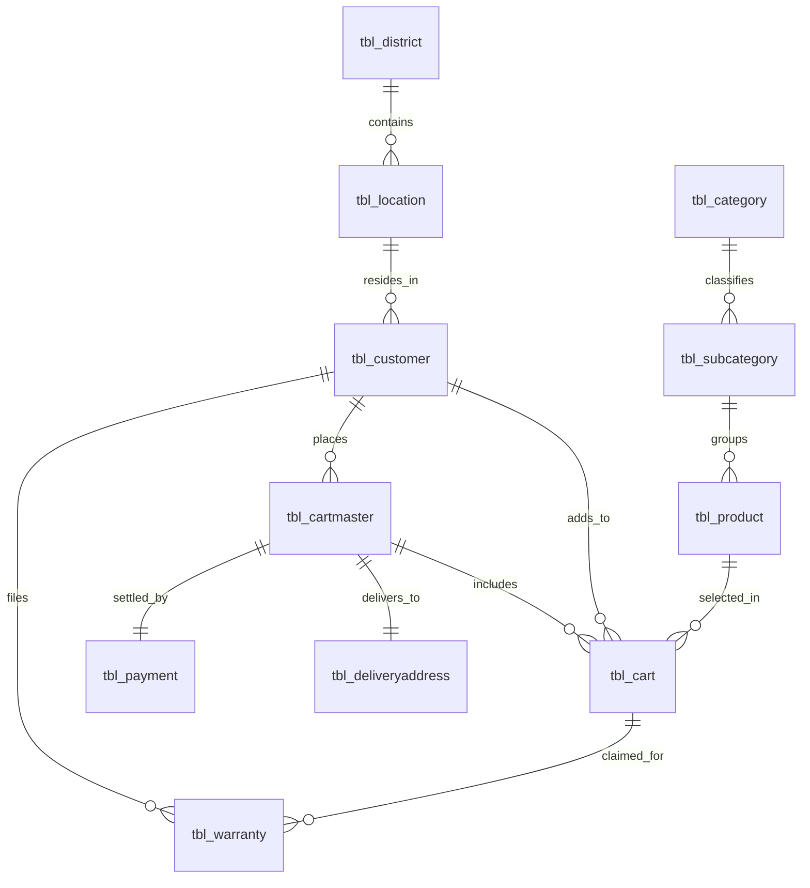

# DATABASE DOCUMENTATION: OrchestraOne (`db_orchestraone`)
**Complete Relational Schema Specification, Data Dictionary, & Relationship Analysis**

---

## 1. Database Overview
* **Database Name:** `db_orchestraone`
* **Default Storage Engine:** `InnoDB`
* **Default Character Set:** `utf8mb4`
* **Default Collation:** `utf8mb4_general_ci`
* **Total Tables:** 12 active relational tables

---

## 2. Comprehensive Data Dictionary (All 12 Tables)

### Table 1: `tbl_adminlogin`
* **Purpose:** Stores authentication credentials for store administrators.
* **Storage Engine:** `InnoDB`

| Column Name | Data Type | Nullable | Key | Default | Description |
| :--- | :--- | :--- | :--- | :--- | :--- |
| `loginid` | `INT` | No | **PK** | Auto Increment | Unique administrator record identifier. |
| `username` | `VARCHAR(50)` | No | | None | Administrator username used at login. |
| `password` | `VARCHAR(50)` | No | | None | Administrator login credential string. |

---

### Table 2: `tbl_customer`
* **Purpose:** Stores profile, contact, and authentication data for registered musicians/customers.
* **Storage Engine:** `InnoDB`

| Column Name | Data Type | Nullable | Key | Default | Description |
| :--- | :--- | :--- | :--- | :--- | :--- |
| `customer_id` | `INT` | No | **PK** | Auto Increment | Unique customer identifier. |
| `customer_name`| `VARCHAR(50)` | No | | None | Full legal or display name of the customer. |
| `location_id` | `INT` | No | **FK** | None | References `tbl_location(location_id)`. |
| `phone_no` | `BIGINT` | No | | None | 10-digit primary telephone / contact number. |
| `email` | `VARCHAR(50)` | No | | None | Unique customer email address for alerts. |
| `username` | `VARCHAR(50)` | No | **UNIQUE** | None | Unique login username. |
| `password` | `VARCHAR(50)` | No | | None | Password credential for authentication. |
| `reg_date` | `DATE` | No | | None | Calendar date when registration occurred. |

---

### Table 3: `tbl_district`
* **Purpose:** Stores primary administrative geographic regions/districts for delivery localization.
* **Storage Engine:** `InnoDB`

| Column Name | Data Type | Nullable | Key | Default | Description |
| :--- | :--- | :--- | :--- | :--- | :--- |
| `district_id` | `INT` | No | **PK** | Auto Increment | Unique district identifier. |
| `district_name` | `VARCHAR(50)` | No | | None | Geographic district name (e.g., Ernakulam, Idukki). |

---

### Table 4: `tbl_location`
* **Purpose:** Stores localized towns, hubs, or sub-regions linked to specific districts.
* **Storage Engine:** `InnoDB`

| Column Name | Data Type | Nullable | Key | Default | Description |
| :--- | :--- | :--- | :--- | :--- | :--- |
| `location_id` | `INT` | No | **PK** | Auto Increment | Unique location identifier. |
| `location_name` | `VARCHAR(50)` | No | | None | Specific city/town name (e.g., Kaloor, Thodupuzha). |
| `district_id` | `INT` | No | **FK** | None | References `tbl_district(district_id)`. |

---

### Table 5: `tbl_category`
* **Purpose:** High-level classification representing major musical instrument families.
* **Storage Engine:** `InnoDB`

| Column Name | Data Type | Nullable | Key | Default | Description |
| :--- | :--- | :--- | :--- | :--- | :--- |
| `category_id` | `INT` | No | **PK** | Auto Increment | Unique instrument category identifier. |
| `category_name` | `VARCHAR(50)` | No | | None | Category title (e.g., Stringed Instruments, Keyboards). |
| `category_image`| `VARCHAR(50)` | No | | None | Image asset filename stored in `uploads/`. |

---

### Table 6: `tbl_subcategory`
* **Purpose:** Specialized sub-classifications nested beneath parent categories.
* **Storage Engine:** `InnoDB`

| Column Name | Data Type | Nullable | Key | Default | Description |
| :--- | :--- | :--- | :--- | :--- | :--- |
| `subcategory_id`| `INT` | No | **PK** | Auto Increment | Unique subcategory identifier. |
| `name` | `VARCHAR(200)`| No | | None | Subcategory name (e.g., Acoustic Guitars, Digital Pianos). |
| `image` | `VARCHAR(255)`| No | | None | Showcase image asset filename in `uploads/`. |
| `description` | `TEXT` | No | | None | Acoustic and hardware overview text. |
| `category_id` | `INT` | No | **FK** | None | References `tbl_category(category_id)`. |

---

### Table 7: `tbl_product`
* **Purpose:** The central instrument catalog storing individual items, pricing, tonewood specs, and inventory counts.
* **Storage Engine:** `InnoDB`

| Column Name | Data Type | Nullable | Key | Default | Description |
| :--- | :--- | :--- | :--- | :--- | :--- |
| `product_id` | `INT` | No | **PK** | Auto Increment | Unique instrument product identifier. |
| `product_name` | `VARCHAR(50)` | No | | None | Product title (e.g., Yamaha F310 Folk Guitar). |
| `subcat` | `INT` | No | **FK** | None | Foreign key referencing `tbl_subcategory(subcategory_id)`. |
| `subcategory_id`| `INT` | Yes | Virtual | Generated | Virtual column alias: `ALWAYS AS (subcat) VIRTUAL`. |
| `amount` | `DECIMAL(10,2)`| No | | `0.00` | Unit selling price formatted to 2 decimals. |
| `image` | `VARCHAR(50)` | No | | None | High-resolution instrument photo in `uploads/`. |
| `stock` | `INT` | No | | None | Real-time physical inventory quantity available. |
| `pstatus` | `VARCHAR(50)` | No | | `'available'` | Availability indicator (`'available'` / `'Unavailable'`). |
| `brand` | `VARCHAR(50)` | No | | None | Manufacturer or luthier brand name (e.g., Fender, Yamaha). |
| `description` | `TEXT` | Yes | | NULL | Full tonewood and acoustic profile specifications. |

---

### Table 8: `tbl_cart`
* **Purpose:** Tracks line items selected by customers before and after checkout.
* **Storage Engine:** `InnoDB`

| Column Name | Data Type | Nullable | Key | Default | Description |
| :--- | :--- | :--- | :--- | :--- | :--- |
| `cart_id` | `INT` | No | **PK** | Auto Increment | Unique cart line item identifier. |
| `product_id` | `INT` | No | **FK** | None | References `tbl_product(product_id)`. |
| `quantity` | `INT` | No | | None | Number of units selected by customer. |
| `totalamount` | `DECIMAL(10,2)`| No | | `0.00` | Computed line total (`quantity * product.amount`). |
| `customer_id` | `INT` | No | **FK** | None | References `tbl_customer(customer_id)`. |
| `cart_date` | `DATE` | No | | None | Date when item was added to cart. |
| `status` | `VARCHAR(20)` | No | | `'cart'` | Status lifecycle (`'cart'` = active; `'paid'` = ordered). |
| `cartmaster_id`| `INT` | Yes | **FK** | NULL | Linked master order ID once checkout completes. |

---

### Table 9: `tbl_cartmaster`
* **Purpose:** Represents the master order record created upon successful checkout.
* **Storage Engine:** `InnoDB`

| Column Name | Data Type | Nullable | Key | Default | Description |
| :--- | :--- | :--- | :--- | :--- | :--- |
| `cartmaster_id`| `INT` | No | **PK** | Auto Increment | Unique master order reference identifier. |
| `grandtotal` | `DECIMAL(10,2)`| No | | `0.00` | Aggregated monetary total of all line items. |
| `customer_id` | `INT` | No | **FK** | None | References `tbl_customer(customer_id)`. |
| `cmstatus` | `VARCHAR(50)` | No | | `'paid'` | Order processing status (e.g., `'Paid'`). |

---

### Table 10: `tbl_deliveryaddress`
* **Purpose:** Stores verified physical delivery destination information for dispatched orders.
* **Storage Engine:** `InnoDB`

| Column Name | Data Type | Nullable | Key | Default | Description |
| :--- | :--- | :--- | :--- | :--- | :--- |
| `deliveryaddressid`| `INT` | No | **PK** | Auto Increment | Unique delivery address identifier. |
| `personname` | `VARCHAR(50)` | No | | None | Recipient contact person name. |
| `mobno` | `BIGINT` | No | | None | Contact telephone number for courier dispatch. |
| `address` | `VARCHAR(100)`| No | | None | Detailed physical street, building, and landmark. |
| `pincode` | `INT` | No | | None | 6-digit postal code. |
| `cartmasterid` | `INT` | No | **FK** | None | Foreign key referencing `tbl_cartmaster(cartmaster_id)`. |
| `cartmaster_id`| `INT` | Yes | Virtual | Generated | Virtual column alias: `ALWAYS AS (cartmasterid) VIRTUAL`. |

---

### Table 11: `tbl_payment`
* **Purpose:** Records financial transactions, settlement dates, and platform commission.
* **Storage Engine:** `InnoDB`

| Column Name | Data Type | Nullable | Key | Default | Description |
| :--- | :--- | :--- | :--- | :--- | :--- |
| `payment_id` | `INT` | No | **PK** | Auto Increment | Unique payment transaction identifier. |
| `cartmaster_id`| `INT` | No | **FK** | None | References `tbl_cartmaster(cartmaster_id)`. |
| `payment_date` | `DATE` | No | | None | Calendar date of successful payment capture. |
| `pamount` | `DECIMAL(10,2)`| No | | `0.00` | Exact monetary amount settled. |
| `customer_id` | `INT` | No | **FK** | None | References `tbl_customer(customer_id)`. |
| `pstatus` | `VARCHAR(50)` | No | | None | Transaction status (e.g., `'Paid'`). |
| `commission` | `DECIMAL(10,2)`| No | | `0.00` | Calculated platform fee / commission. |

---

### Table 12: `tbl_warranty`
* **Purpose:** Manages customer warranty claims, uploaded proof media, and resolution statuses.
* **Storage Engine:** `InnoDB`

| Column Name | Data Type | Nullable | Key | Default | Description |
| :--- | :--- | :--- | :--- | :--- | :--- |
| `warranty_id` | `INT` | No | **PK** | Auto Increment | Unique warranty claim identifier. |
| `customer_id` | `INT` | No | **FK** | None | References `tbl_customer(customer_id)`. |
| `cart_id` | `INT` | No | **FK** | None | References specific purchased item in `tbl_cart`. |
| `applydate` | `DATE` | No | | None | Date claim was submitted by the customer. |
| `wimg` | `VARCHAR(50)` | No | | None | Uploaded warranty card / receipt file in `uploads/`. |
| `issuedesc` | `VARCHAR(500)`| No | | None | Customer description of instrument defect. |
| `prod_img` | `VARCHAR(50)` | No | | None | Uploaded defect photograph in `uploads/`. |
| `wstatus` | `VARCHAR(50)` | No | | None | Claim status (`'requested'`, `'Accepted'`, `'Rejected'`). |
| `responsedate` | `DATE` | Yes | | NULL | Date administrator reviewed and resolved claim. |

---

## 3. Entity-Relationship (ER) Cardinality Analysis

### Cardinality Breakdown:
1. **`tbl_district` $\rightarrow$ `tbl_location` (1-to-Many):** One district encompasses multiple geographic locations; each location belongs strictly to one district.
2. **`tbl_location` $\rightarrow$ `tbl_customer` (1-to-Many):** One location can have multiple registered customers; each customer resides in one location.
3. **`tbl_category` $\rightarrow$ `tbl_subcategory` (1-to-Many):** One instrument category (e.g., String Instruments) contains multiple subcategories (e.g., Acoustic Guitars, Classical Guitars).
4. **`tbl_subcategory` $\rightarrow$ `tbl_product` (1-to-Many):** One subcategory contains multiple specific instrument products.
5. **`tbl_customer` $\rightarrow$ `tbl_cart` (1-to-Many):** One customer creates multiple cart line items over time.
6. **`tbl_product` $\rightarrow$ `tbl_cart` (1-to-Many):** An individual instrument can appear as a line item across multiple customer carts.
7. **`tbl_cartmaster` $\rightarrow$ `tbl_cart` (1-to-Many):** Once checked out, a master order links one or more line items (`cartmaster_id`).
8. **`tbl_cartmaster` $\rightarrow$ `tbl_deliveryaddress` (1-to-1):** Each master order has exactly one recorded shipping delivery address.
9. **`tbl_cartmaster` $\rightarrow$ `tbl_payment` (1-to-1):** Each paid order is linked directly to one payment transaction record.
10. **`tbl_cart` $\rightarrow$ `tbl_warranty` (1-to-Many):** A specific purchased cart item can have warranty claims filed against it.

---

## 4. Normalization Audit & Optimization Notes

* **1NF:** Satisfied across all tables; every field contains atomic values and all records have unique primary keys.
* **2NF:** Satisfied across all tables; all tables utilize single-column primary keys (`*_id`), eliminating partial key dependencies.
* **3NF Considerations:**
  * In strict theoretical 3NF, `tbl_cart.totalamount` is derived (`quantity * product.amount`). However, storing it avoids expensive runtime joins and multiplication across high-volume checkout queries.
  * In `tbl_payment` and `tbl_warranty`, `customer_id` is retained alongside `cartmaster_id` and `cart_id` to allow direct, fast indexing and filtering without multi-table outer joins.
* **Virtual Generated Columns:** Added `cartmaster_id` to `tbl_deliveryaddress` and `subcategory_id` to `tbl_product` using MySQL virtual generated columns to allow standard ORM and foreign key references without breaking legacy procedural queries.
