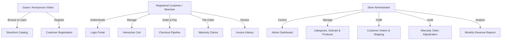

# PROJECT OVERVIEW: OrchestraOne (MelodyMart)
**A Comprehensive Technical Specification & System Overview**

---

## 1. Executive Summary
**OrchestraOne** (internally branded in customer-facing views as **MelodyMart**) is an end-to-end, web-based musical instrument e-commerce platform and digital warranty management system. Developed using a robust server-side PHP backend and a MySQL relational database, OrchestraOne addresses the specialized requirements of musical equipment retailing: high-precision acoustic specifications, brand authenticity verification, multi-tiered category exploration, inventory management, dynamic shopping cart calculation, automated invoice generation, and post-sale digital warranty claim tracking.

The application bridges the operational gap between traditional musical instrument brick-and-mortar stores and modern online retail ecosystems. It replaces manual paperwork, in-person warranty registrations, and disorganized stock management with a unified, database-driven web application.

---

## 2. Problem Statement
Traditional musical instrument retail faces distinct operational bottlenecks that generic retail frameworks often fail to resolve:

1. **Acoustic & Hardware Spec Complexity:** Musical instruments require exhaustive specification tracking—such as tonewood composition, pickup hardware, brand calibration, and setup verification—which generic retail templates do not display cleanly.
2. **Post-Purchase Warranty Friction:** Instruments frequently require warranty assistance (e.g., truss rod defects, hairline soundboard cracks, faulty preamps, electronic pot noise). Traditional stores rely on paper receipts and printed warranty cards, which customers frequently misplace, leading to warranty claim disputes and luthier verification delays.
3. **Cart & Inventory Desynchronization:** In musical instrument sales, items are often high-value with limited stock. If a shopping system allows duplicate line items or fails to enforce live stock bounds, customers can accidentally place impossible orders, causing logistics failures.
4. **Disorganized Administration:** Store owners and luthiers often lack centralized dashboards to monitor sales metrics, track order fulfillment statuses, verify customer shipping destinations, and review warranty defect proof photos.

---

## 3. Proposed Solution & Objectives
OrchestraOne resolves these challenges through an integrated, three-tier web application designed to achieve the following core objectives:

* **Centralized Instrument Catalog:** Provide a hierarchical, two-level navigation model (Categories $\rightarrow$ Subcategories $\rightarrow$ Instruments) enabling musicians to quickly locate specialized gear (e.g., Acoustic Guitars, Solid-body Electrics, Digital Pianos, Studio Monitors).
* **Deterministic Shopping Cart Workflow:** Implement a robust cart mechanism with strict single-instance line item verification (preventing accidental duplicate entries), live quantity steppers, subtotal updates, and boundary constraints tied directly to inventory availability.
* **Streamlined Checkout Pipeline:** Execute an intuitive 3-step checkout workflow: **Cart Review** $\rightarrow$ **Delivery Destination Capture** $\rightarrow$ **Payment Settlement & Invoice Generation**.
* **End-to-End Digital Warranty Lifecycle:** Enable verified buyers to file digital warranty claims against past purchases by uploading digital receipts and defect photographs, while giving administrators approval and status tracking capabilities.
* **Executive Administrative Command:** Provide store administrators with real-time analytics, visual revenue charts (monthly billing, commission breakdowns), quick stock adjustment modals, and printable dispatch packing slips.

---

## 4. System Stakeholders & Intended Users

The system is architected for three distinct personas:

### A. Guest / Anonymous Visitor
* **Access Level:** Public (unauthenticated).
* **Capabilities:** Browses top-level categories and featured instruments on the storefront; accesses customer registration with dynamic district-location dropdowns; accesses the centralized sign-in portal.
* **Restrictions:** Cannot add items to cart, view checkout screens, or submit warranty claims without logging in.

### B. Customer (Musician / Buyer)
* **Access Level:** Authenticated via `tbl_customer` credentials (`$_SESSION['customer_id']`).
* **Capabilities:** Explores detailed instrument hardware specifications; adds products to cart; dynamically adjusts order quantities; provides shipping addresses; completes simulated payments; downloads itemized invoices; tracks past orders; submits warranty claims with photographic proof.

### C. Administrator (Store Manager / Luthier Lead)
* **Access Level:** Authenticated via `tbl_adminlogin` credentials (`$_SESSION['username']`, `$_SESSION['Login_id']`).
* **Capabilities:** Full CRUD over Categories, Subcategories, Products, Districts, and Locations; monitors high-level platform KPI counters; executes quick inline stock adjustments; accesses order invoices and packing slips; approves or rejects warranty defect claims; exports monthly financial records to Excel.

---

## 5. Main Functional Features

| Category | Feature | Description |
| :--- | :--- | :--- |
| **Authentication** | Dual-Role Login | Single sign-in portal (`login.php`) dynamically routes administrators to `Admin/index.php` and customers to `Customer/index.php`. |
| **Registration** | Cascading Geographic Dropdown | AJAX-powered district-to-location dependent dropdowns ensure customers select valid geographic locations. |
| **Validation** | Real-Time Username Check | Asynchronous AJAX check (`check_username.php`) verifies username uniqueness prior to form submission. |
| **Catalog** | Hierarchical Taxonomy | Two-level classification (`tbl_category` $\rightarrow$ `tbl_subcategory` $\rightarrow$ `tbl_product`) organizes complex instrument inventories. |
| **Product Showcase** | Dynamic Spec & Subtotal Viewer | Displays tonewood profiles, master luthier badges, dynamic quantity stepper, and live subtotal calculations. |
| **Cart Integrity** | Duplicate Item Prevention | Intercepts cart additions (`cartaction.php`) and prevents duplicate rows for the same product, directing users to adjust quantity in cart. |
| **Checkout** | 3-Step Guided Pipeline | Clean progression indicator: Cart Review $\rightarrow$ Shipping Details $\rightarrow$ Payment Verification. |
| **Invoicing** | Itemized Dispatch Slips | Generates structured invoice documents (`orderdetail.php`) formatted for standard 80mm/A4 thermal and laser printing. |
| **Warranty** | Digital Proof Claim System | Allows customers to select purchased items, describe tonal/hardware flaws, and upload warranty cards and defect photos. |
| **Analytics** | Visual Revenue Reporting | Renders monthly platform sales using Chart.js bar and pie charts, with custom date range filtering and Excel file export. |

---

## 6. Practical Real-World Example
1. **Musician Browses:** Alex visits OrchestraOne looking for an acoustic guitar. He browses *String Instruments* $\rightarrow$ *Acoustic Guitars* $\rightarrow$ *Yamaha F310 Folk Guitar*.
2. **Cart Addition:** Alex logs in (`customer` / `customer`). He selects a quantity of 1 and clicks **Add to Cart**.
3. **Duplicate Interception:** Alex returns to the product page and clicks **Add to Cart** again. The application intercepts the request, alerts *"Item is already in cart"*, and routes him to `cartview.php`.
4. **Checkout & Payment:** Alex reviews his cart (₹9,500.00), enters his shipping destination in Ernakulam, confirms delivery details, and proceeds to the payment portal.
5. **Invoice Generation:** The transaction completes; stock is decremented in `tbl_product`; Alex receives order reference `#MM-ORD-00016` and can view his printable invoice.
6. **Admin Dispatch:** The store admin logs in (`admin` / `admin`), opens **Customer Orders**, clicks `#MM-ORD-00016`, reviews the shipping address, and prints the packing slip.
7. **Warranty Claim:** Six months later, Alex experiences bridge lift on the guitar. He navigates to **Warranty**, selects the Yamaha guitar from his paid orders, attaches a photo of the defect, and submits the claim. The administrator reviews the claim photo in `Admin/warrantyview.php` and marks it **Accepted**.

---

## 7. Scope and Project Boundaries
* **In Scope:** Complete localized instrument catalog management; customer registration and session authorization; shopping cart state management; multi-step shipping and simulated payment capture; digital warranty management; admin analytics and order dispatch.
* **Out of Scope (Current Architecture):** Live external banking payment gateways (Stripe/Razorpay webhook callbacks); live real-time courier tracking APIs (e.g. FedEx, BlueDart); automated SMS gateways. (Simulated payment settlement and database-driven statuses are implemented).
