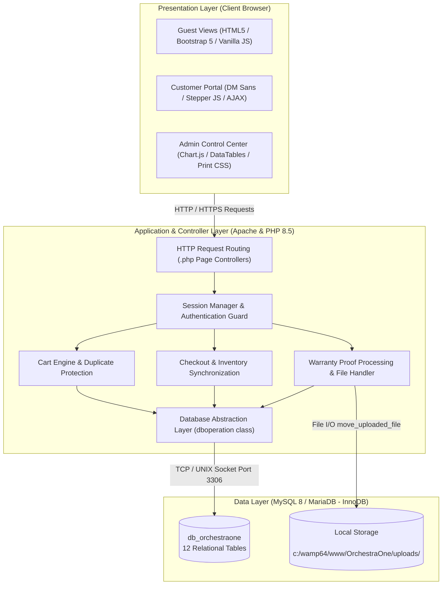
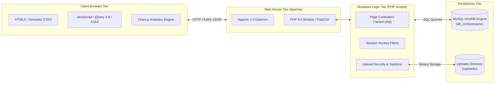
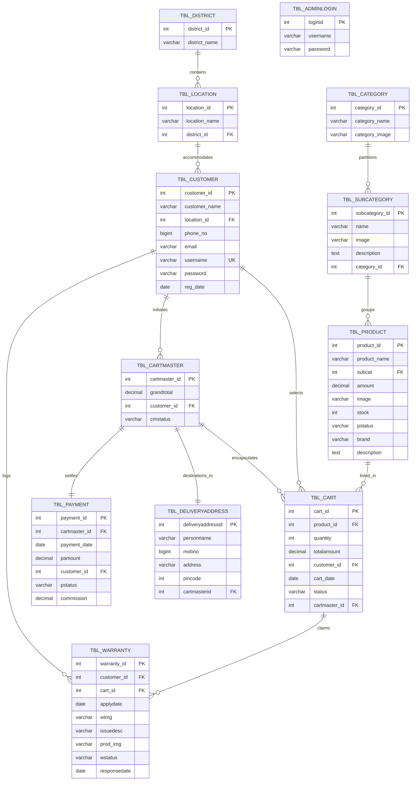
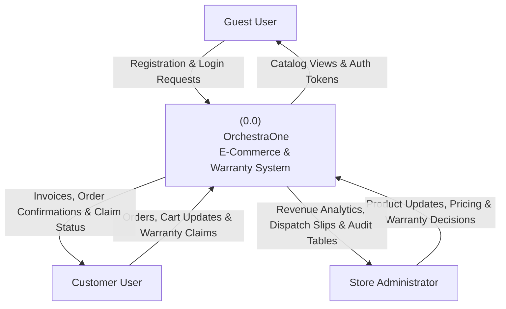
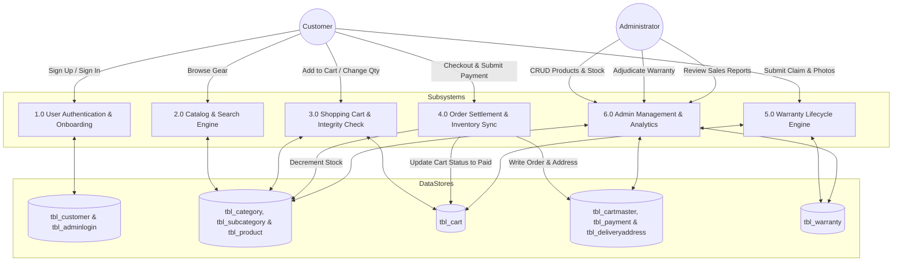
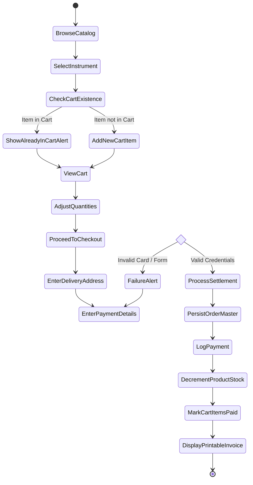
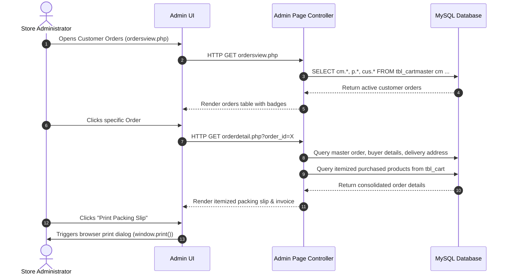
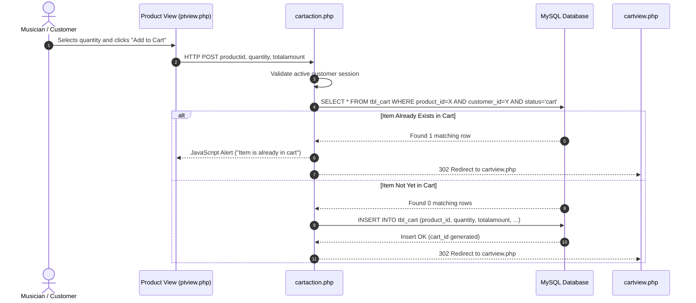
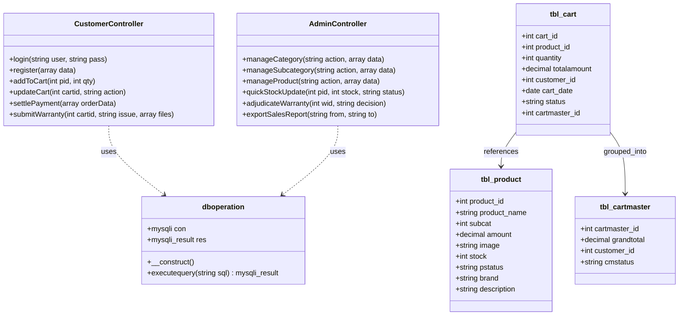

# SYSTEM ARCHITECTURE & DIAGRAMS: OrchestraOne (MelodyMart)
**Detailed Multi-Tier Architecture & Formal Engineering Diagrams**

---

## 1. Overall System Architecture

OrchestraOne implements a **Classic Three-Tier Web Architecture** combining a presentation layer (Client Browser), application logic layer (Apache 2.4 & PHP 8.5), and data persistence layer (MySQL InnoDB).

---

## 2. Request-Response Lifecycle
1. **Client Request:** The user navigates to a URL (e.g., `Customer/ptview.php?productid=3`) via HTTP GET or submits a form via HTTP POST.
2. **Server Dispatching:** Apache receives the request, evaluates the `.php` extension, and forwards it to the PHP 8 interpreter engine.
3. **Session Verification:** The script starts or resumes the user session (`session_start()`), inspecting `$_SESSION['customer_id']` or `$_SESSION['Login_id']`. Unauthenticated requests to protected endpoints are redirected to `Guest/login.php`.
4. **Data Access (DBAL):** The page instantiates `new dboperation()` and executes parameterized/sanitized queries against `db_orchestraone`.
5. **Business Logic Execution:** The server computes totals, validates inventory availability, checks duplicate cart conditions, or handles file uploads.
6. **HTML Response Rendering:** PHP dynamically embeds query results into the HTML/Bootstrap presentation template and streams the HTTP 200 payload back to the browser.

---

## 3. Comprehensive Diagrams (Mermaid Specifications)

### Diagram 1: System Architecture Diagram

---

### Diagram 2: Use Case Diagram

```mermaid
flowchart TD
    Guest((Guest))
    Customer((Registered Customer))
    Admin((Store Administrator))

    subgraph MelodyMartSystem["OrchestraOne E-Commerce Platform"]
        UC1[Browse Instrument Catalog]
        UC2[Register Customer Account]
        UC3[Login / Authenticate]
        UC4[View Instrument Profile & Specs]
        UC5[Manage Cart Items & Quantities]
        UC6[Checkout & Shipping Entry]
        UC7[Complete Payment Settlement]
        UC8[View Past Orders & Invoices]
        UC9[File Digital Warranty Claim]
        
        UC10[Manage Categories & Subcategories]
        UC11[Manage Instrument Inventory & Stock]
        UC12[Review & Print Customer Invoices]
        UC13[Adjudicate Warranty Claims]
        UC14[View Monthly Sales & Revenue Charts]
    end

    Guest --> UC1
    Guest --> UC2
    Guest --> UC3

    Customer --> UC3
    Customer --> UC4
    Customer --> UC5
    Customer --> UC6
    Customer --> UC7
    Customer --> UC8
    Customer --> UC9

    Admin --> UC3
    Admin --> UC10
    Admin --> UC11
    Admin --> UC12
    Admin --> UC13
    Admin --> UC14
```

---

### Diagram 3: Entity-Relationship (ER) Diagram

---

### Diagram 4: Data Flow Diagram (Level 0 - Context Level)

---

### Diagram 5: Data Flow Diagram (Level 1 - Core Subsystems)

---

### Diagram 6: Customer Activity Diagram (Purchase Workflow)

---

### Diagram 7: Admin Sequence Diagram (Order Fulfillment)

---

### Diagram 8: User Sequence Diagram (Add to Cart & Duplicate Guard)

---

### Diagram 9: Class Diagram (Database Model & Controllers)

