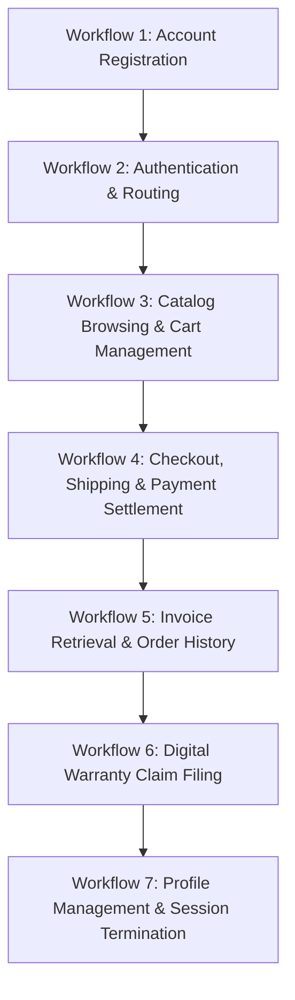
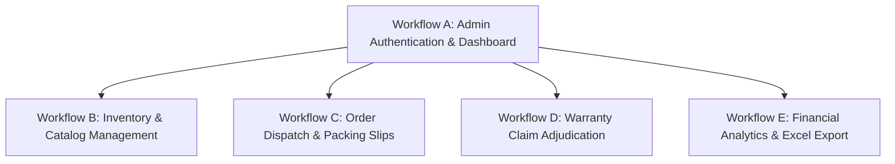

# WORKFLOW DOCUMENTATION: OrchestraOne (MelodyMart)
**End-to-End Operational Workflows for Customers and Administrators**

---

## Part 1: Customer (User) Complete Lifecycle Workflows



---

### Workflow 1: Customer Registration & Geographic Localization
1. **Initiation:** The visitor navigates to `Guest/cusreg.php`.
2. **Geographic Fetch:**
   * Script executes `SELECT * FROM tbl_district ORDER BY district_name ASC` and populates the District dropdown.
   * Visitor selects their home district (e.g., *Ernakulam*).
   * Client-side jQuery triggers an AJAX POST to `Guest/getloc_drop.php` passing `id: district_id`.
   * `getloc_drop.php` queries `tbl_location WHERE district_id = '$did'` and returns `<option>` HTML tags to populate the Location dropdown dynamically.
3. **Username Live Availability Verification:**
   * Visitor types a desired username into the input box.
   * A `keyup` listener triggers an asynchronous request to `Guest/check_username.php`.
   * Queries `tbl_customer WHERE username = '$username'`.
   * Renders green/red badge: *"Username available"* or *"Username already taken"*.
4. **Form Submission:**
   * Submits via POST to `Guest/cusregaction.php`.
   * Backend executes duplicate safety checks on `username` and `email`.
   * Executes SQL:
     ```sql
     INSERT INTO tbl_customer(customer_name, location_id, phone_no, email, username, password, reg_date)
     VALUES ('$cusname', '$locationid', '$phoneno', '$email', '$username', '$password', CURDATE());
     ```
   * Optionally triggers `phpmailer.php` to dispatch confirmation email.
   * Displays JavaScript alert: `"Registration Successful! Please login with your credentials."` and redirects to `Guest/login.php`.

---

### Workflow 2: Customer Authentication & Session Initialization
1. **Initiation:** Visitor opens `Guest/login.php`.
2. **Submission:** Enters username and password; clicks **Sign In**.
3. **Credential Evaluation (`Guest/loginaction.php`):**
   * Checks `tbl_customer WHERE username='$username' AND password='$password'`.
   * On match, initializes session:
     ```php
     $_SESSION["username"] = $username;
     $_SESSION["customer_id"] = $row["customer_id"];
     ```
4. **Redirection:** If the user arrived from a product page, redirects back to that product; otherwise redirects to `Customer/index.php`.

---

### Workflow 3: Instrument Discovery, Cart Addition & Duplicate Guard
1. **Catalog Exploration:**
   * Customer views categories at `Customer/catview.php`.
   * Selects Category $\rightarrow$ Subcategories at `Customer/subcatview.php`.
   * Selects Subcategory $\rightarrow$ Products at `Customer/productview.php`.
2. **Product Specification View (`Customer/ptview.php`):**
   * Customer reviews tonewood specs, pricing, and stock status.
   * Backend queries `tbl_cart` to see if `product_id` is already in their active cart.
   * If present, highlights *"Item is already in cart"*.
3. **Cart Addition (`Customer/cartaction.php`):**
   * Customer selects quantity (bounded by max stock) and submits.
   * Backend executes duplicate check:
     ```sql
     SELECT * FROM tbl_cart WHERE product_id = '$pid' AND customer_id = '$customerid' AND status = 'cart';
     ```
   * **If Duplicate:** Halts insert, fires alert `"Item is already in cart"`, and redirects to `cartview.php`.
   * **If New Item:** Executes:
     ```sql
     INSERT INTO tbl_cart (product_id, quantity, totalamount, customer_id, cart_date, status)
     VALUES ('$pid', '$quantity', '$tamount', '$customerid', CURDATE(), 'cart');
     ```
     Redirects to `Customer/cartview.php`.
4. **Quantity Adjustments (`Customer/updatecart.php`):**
   * Customer clicks `+` or `-` in the cart stepper.
   * Verifies requested quantity against `tbl_product.stock`.
   * Updates line item total: `UPDATE tbl_cart SET quantity = $newQty, totalamount = $newTotal WHERE cart_id = $cartid`.

---

### Workflow 4: Checkout, Shipping Capture & Payment Settlement
1. **Initiation:** In `Customer/cartview.php`, customer clicks **Proceed to Checkout**.
2. **Shipping Capture (`Customer/deliveryaddress.php`):**
   * Pre-loads any existing delivery address.
   * Customer inputs recipient name, phone, address, and 6-digit postal pincode.
   * Submits to Step 3 (Payment).
3. **Payment Form (`Customer/payment.php`):**
   * Customer reviews order summary and inputs 16-digit card details, MM/YY expiration, and CVV.
4. **Atomic Transaction Settlement (`Customer/paymentaction.php`):**
   * **Insert Order Master:**
     ```sql
     INSERT INTO tbl_cartmaster(grandtotal, customer_id, cmstatus) VALUES ('$grandTotal', '$customerid', 'Paid');
     ```
     Captures generated `$cartId`.
   * **Insert Payment:**
     ```sql
     INSERT INTO tbl_payment(cartmaster_id, payment_date, pamount, customer_id, pstatus, commission)
     VALUES ('$cartId', CURDATE(), '$grandTotal', '$customerid', 'Paid', '$commission');
     ```
   * **Insert Delivery Address:**
     ```sql
     INSERT INTO tbl_deliveryaddress(personname, mobno, address, pincode, cartmasterid)
     VALUES ('$personname', '$mobno', '$address', '$pincode', '$cartId');
     ```
   * **Migrate Cart Items:**
     ```sql
     UPDATE tbl_cart SET status = 'paid', cartmaster_id = '$cartId' WHERE customer_id = '$customerid' AND status = 'cart';
     ```
   * **Decrement Inventory:** For each purchased item:
     ```sql
     UPDATE tbl_product SET stock = stock - '$quantity' WHERE product_id = '$productId';
     ```
   * Redirects to `Customer/ordersuccess.php?order_id=$cartId`.

---

### Workflow 5: Order History & Digital Invoice Printing
1. **Customer Navigation:** Navigates to `Customer/vieworders.php`.
2. **Querying:** Joins `tbl_payment`, `tbl_cartmaster`, `tbl_cart`, and `tbl_product` where `customer_id = '$customerid'` and `status = 'paid'`.
3. **Display:** Displays itemized instrument cards, order references (`#MM-ORD-XXXXX`), payment dates, and action buttons.
4. **Printing:** Clicking **Print Invoice** invokes `Admin/orderdetail.php` or `Customer/ordersuccess.php` with print stylesheets.

---

### Workflow 6: Digital Warranty Claim Submission
1. **Initiation:** In `vieworders.php`, customer identifies a purchased instrument and clicks **Claim Digital Warranty**.
2. **Claim Form (`Customer/warranty.php?cartid=X`):**
   * Displays purchased instrument name and image.
   * Customer inputs issue description (e.g., *"Pickup hum and neck fret buzz"*).
   * Customer attaches photo of warranty card (`wimg`) and photo of defect (`proimg`).
3. **Processing (`Customer/warrantyaction.php`):**
   * Sanitizes filenames and saves to `c:/wamp64/www/OrchestraOne/uploads/`.
   * Executes SQL:
     ```sql
     INSERT INTO tbl_warranty (customer_id, cart_id, applydate, wimg, issuedesc, prod_img, wstatus)
     VALUES ('$customerid', '$cartid', CURDATE(), '$wimg', '$issue', '$proimg', 'requested');
     ```
   * Fires confirmation alert and redirects to `Customer/warrantyview.php`.

---

## Part 2: Administrator Complete Management Workflows



---

### Workflow A: Admin Authentication & Executive Monitoring
1. **Authentication:** Administrator opens `Guest/login.php`, inputs `admin` / `admin`.
2. **Session Initialization:** `Guest/loginaction.php` verifies `tbl_adminlogin`, sets `$_SESSION["Login_id"] = 1`, and redirects to `Admin/index.php`.
3. **Executive Dashboard (`Admin/index.php`):**
   * Aggregates platform KPIs: Total Categories, Total Products, Total Registered Musicians, Pending Warranty Claims.
   * Aggregates monthly revenue:
     ```sql
     SELECT MONTH(payment_date) AS month_no, DATE_FORMAT(payment_date, '%M') AS month_name, SUM(commission) AS total_payment
     FROM tbl_payment WHERE pstatus = 'Paid' GROUP BY month_no, month_name ORDER BY month_no;
     ```
   * Injects data arrays into Chart.js to render the monthly revenue bar chart.

---

### Workflow B: Catalog & Inventory Management
1. **Category Management:**
   * Admin navigates to `Admin/category.php`.
   * Enters Category Name, uploads Category Photo (`uploads/`).
   * Submits to `Admin/categoryaction.php` (`INSERT INTO tbl_category`).
2. **Subcategory Management:**
   * Navigates to `Admin/subcategory.php`.
   * Selects Parent Category dropdown, enters subcategory title, acoustic description, and image.
   * Submits to `Admin/subcategoryaction.php` (`INSERT INTO tbl_subcategory`).
3. **Product Inventory Setup:**
   * Navigates to `Admin/product.php`.
   * Selects Category $\rightarrow$ AJAX populates Subcategory.
   * Enters Product Name, Unit Price, Stock Units, Brand, and Tonewood Profile.
   * Submits to `Admin/productaction.php` (`INSERT INTO tbl_product`).
4. **Quick Stock Adjustment Modal:**
   * In `Admin/productview.php`, admin clicks **Quick Stock** next to any instrument.
   * Modal opens without page refresh; admin updates stock count or toggles availability (`available` / `Unavailable`).
   * Submits to `Admin/producteditaction.php`.

---

### Workflow C: Order Fulfillment & Packing Slip Invoicing
1. **Order Review:** Administrator opens `Admin/ordersview.php`.
2. **Listing:** Queries all master orders, displaying grand total, date, customer name, and item count.
3. **Invoice Generation (`Admin/orderdetail.php?order_id=X`):**
   * Retrieves master record, shipping destination from `tbl_deliveryaddress`, and purchased items from `tbl_cart`.
   * Formats a packing slip.
   * Admin clicks **Print Invoice / Packing Slip** (`window.print()`).
   * Warehouse staff packs the custom instrument carton with the printed slip.

---

### Workflow D: Warranty Claim Adjudication
1. **Notification:** Header badge in `Admin/header.php` shows count of pending claims (`wstatus = 'requested'`).
2. **Inspection (`Admin/warrantyview.php`):**
   * Admin reviews the customer's written defect description.
   * Clicks thumbnail to inspect the full-resolution defect photo in `uploads/`.
3. **Decision Execution (`Admin/warrantyaction.php`):**
   * Admin clicks **Approve Claim** (`action=accept&wid=X`) or **Reject Claim** (`action=reject&wid=X`).
   * Executes SQL:
     ```sql
     UPDATE tbl_warranty SET wstatus = 'Accepted' (or 'Rejected'), responsedate = CURDATE() WHERE warranty_id = '$wid';
     ```
   * Customer sees updated status instantly in their portal.

---

### Workflow E: Sales Auditing & Excel Export
1. **Filtering:** Admin navigates to `Admin/datewisereport.php`.
2. **Date Input:** Inputs `from` (e.g., `2026-01-01`) and `to` (e.g., `2026-11-30`); clicks **Filter Records**.
3. **On-Screen Audit:** Displays matching paid transactions with customer names and amounts.
4. **Export Action:** Admin clicks **Export to Excel**.
5. **Execution (`Admin/exportexcel.php`):**
   * Re-runs the query and outputs the table under headers `Content-Type: application/vnd.ms-excel; filename=MelodyMart_Sales_Report.xls`.
   * Browser triggers an immediate `.xls` file download.
